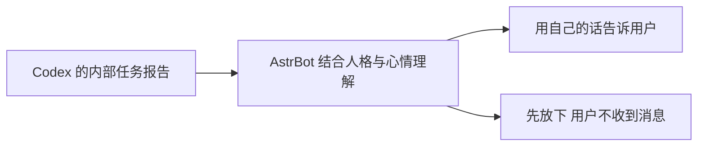

# Codex 是给 AstrBot 发内部消息

[返回首页](../README.md) · [配置说明](CONFIGURATION.md) · [插件联动](LINKING.md)

用户委托 AstrBot 做事，AstrBot 可以交给 Codex。之后 Codex 的报告只交给 AstrBot，用户尚未看过原文。用户最终知道什么，取决于 AstrBot 实际对用户说了什么。

人格与拟人感优先于播报功能。任务新进展是它在相处中得知的消息，正常情况下会用自己的方式分享：可以简短、随性、带玩笑与感受，不要求变成客服、照读模板或每条打卡。它仍可依主提示词中的人格、当前关系与情境选择少说、暂不展开或拒绝，播报不能压过人格。

愿意转述时，让没读过报告的人自然听懂是哪件事、这次怎样了。语气可以有情绪，任务事实应准确；“准备修改”不等于“已经完成”，上一轮的结果也不等于这一轮已收尾。没有转述的结果不视为用户已知。

监控发现任务刚开始、还没有公开正文时，只记录状态，不触发播报。完成、失败、中断、系统错误及等待输入或审批仍会交回 AstrBot。内部播报只加载文字上下文，历史图片和音频以附件提示代替，避免旧媒体下载拖垮任务报告；保存历史前还原原有附件，普通用户聊天继续按原流程处理媒体。

例如 Codex 发来测试结果与一段代码里的测试字符串，AstrBot 可以只说“刚才那个项目修好了，测试也过了”。不必把内部格式、测试原话和辨认来源的过程念给用户。

## 有情绪，也可以不想理

搭配短期共享情绪时，它可以对这条内部播报产生兴趣、嫌吵、疲惫或暂时不想管。是否回应由当前人格、心情和任务内容决定，不设固定拒答概率。

桥接在情绪插件处理本轮后，读取实际可用的联动与拒播能力：未启用联动时保留主提示词人格的自主表达，不虚构情绪插件状态；启用时让短期心境自然改变表达；情绪插件允许拒播时可选择静默放下。关闭情绪拒播能力只关闭该插件提供的拒播机制，不把人格改成强制汇报员。

不想接时可以在内部先放下；想对用户说点什么时，也应让没见过报告的用户听得懂。用户没有发过这条报告，不能把对 Codex 的不耐烦当成用户刚刚在反复打扰。

短期情绪配置中的“也可以不理 Codex 的内部报告”默认开启，跟随“允许自主表达不愿意或拒绝”。支持工具调用的模型可调用 `mood_ignore_codex_notice` 静默跳过当前报告。决定静默时先使用工具，不要先输出文字。已经说出的内容不会撤回。

静默放下不取消 Codex 的任务，也不删除结果。结果仍可在状态与记录中查看；用户之后问起来时，AstrBot 再按当时的语境接话。这不会新建一个给 Codex 的任务，也不会承诺自动在某个时间重播。

## 其他插件怎样识别

`event.get_extra("w1_event")` 中包含：

| 字段 | 值 |
| --- | --- |
| source | codex_bridge |
| recipient | astrbot |
| visibility | internal |
| user_has_seen_report | false |
| type | task_event |
| is_user_message | false |
| counts_as_user_activity | false |

正文与历史也保留内部报告的来源。用户真正看到的内容应以 AstrBot 已发送的消息为准。

静默放下时另有 `w1_notice_disposition`，其中 `action=ignore`。自娱自乐不会把它当成已经发过一条闲聊，桥接也不会把它当成已经转述；无人回应记录与真实交流时间不会被这次内部收件清掉。

只安装桥接时仍可正常接收和转达报告。只安装短期情绪时仍能用于普通聊天。联动能力按实际安装情况自然出现。
